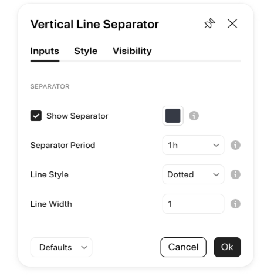
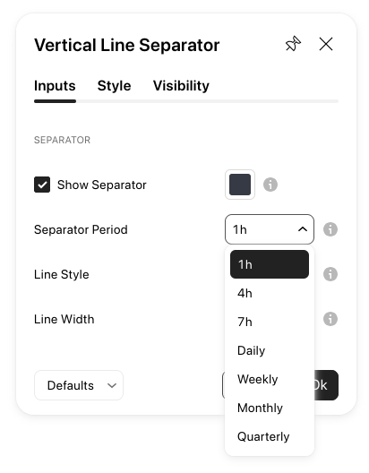
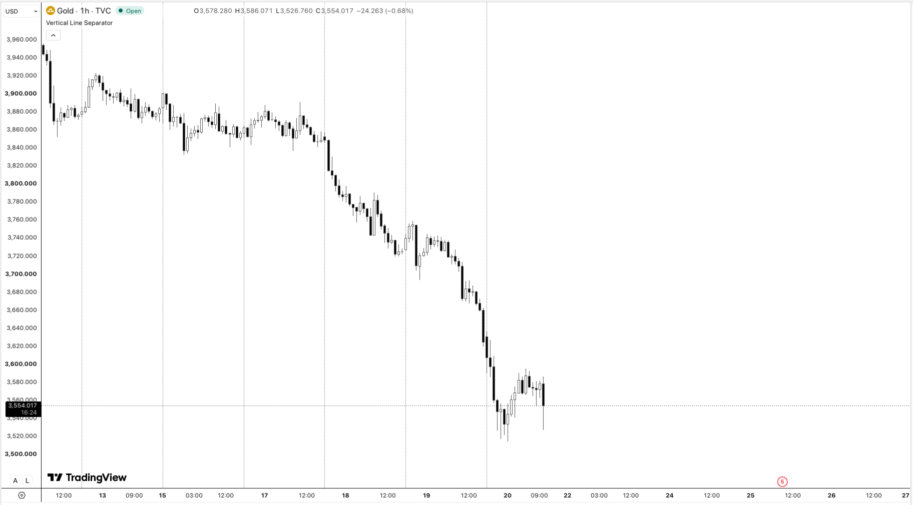
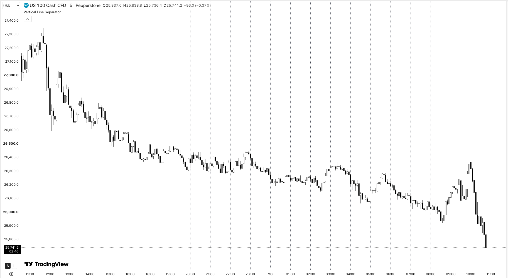

# Vertical Line Separator

A TradingView (Pine Script v6) indicator that draws vertical divider lines whenever a new separator period begins. Use it to visually separate intraday sessions, days, weeks, months, or other larger time periods on the chart.

The indicator supports 1-hour, 4-hour, 7-hour, daily, weekly, monthly, and quarterly separators, with configurable line color, style, and width.

* * *

## Installation

1. Open the [`VLS.pine`](./VLS.pine) file in this repo and copy the full code.
2. Go to **TradingView** (web or desktop app).
3. Open **Pine Editor** → **New indicator**.
4. Delete the placeholder template code and paste the copied script.
5. Click **Add to Chart**.

That's it — no external dependencies required.

* * *

## Settings

All inputs are configurable from the indicator's settings panel.

| Input | Description |
| --- | --- |
| **Show Separator** | Enables or disables the vertical separator lines. |
| **Separator Period** | Selects when a new separator is drawn: 1h, 4h, 7h, Daily, Weekly, Monthly, or Quarterly. |
| **Line Color** | Sets the color of the separator lines. |
| **Line Style** | Sets the line style to Dotted, Solid, or Dashed. |
| **Line Width** | Sets the separator line thickness from 1 to 5. |

* * *

## Examples

### Daily Separators

Vertical dotted lines marking the start of each new Daily Timeframe period.

### 1-Hour Separators on a Lower Timeframe

The same separator can be used on lower-timeframe charts to divide each selected period clearly.

* * *

## License

Mozilla Public License 2.0 — © MadMataTrader. See [`LICENSE`](./LICENSE) for details.